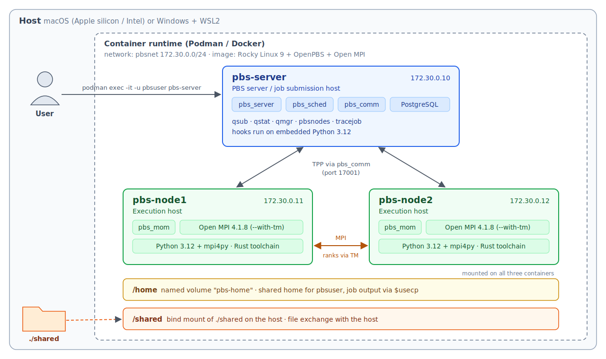

# Installation of OpenPBS Cluster Containers

This document describes how to set up a local, container-based OpenPBS development environment. The environment is intended for developing and testing QRMI and PBS hooks without access to a production HPC cluster.

## Jump To

- [Container Contents](#container-contents)
- [Prerequisites](#prerequisites)
- [Creating a Docker-based OpenPBS Cluster](#creating-a-docker-based-openpbs-cluster)
  - [1. Building the containers](#1-building-the-containers)
  - [2. Starting the cluster](#2-starting-the-cluster)
  - [3. Verifying the cluster](#3-verifying-the-cluster)
  - [4. Stopping and cleaning up](#4-stopping-and-cleaning-up)
- [Slurm to PBS Command Reference](#slurm-to-pbs-command-reference)
- [Image Details](#image-details)
- [Customizing the Cluster](#customizing-the-cluster)
- [Troubleshooting](#troubleshooting)

## Container Contents

All cluster nodes are built from the same base image with the following software stack:

| Component | Version | Notes |
|-----------|---------|-------|
| Base OS   | Rocky Linux 9 | RHEL 9–compatible base image |
| OpenPBS   | `master` @ `cd7ab5ed` (2026-04-10) | Workload manager (`pbs_server`, `pbs_sched`, `pbs_comm`, `pbs_mom`) |
| Python    | 3.12 | Embedded in OpenPBS; used by hooks and `pbs_python` |
| PostgreSQL | Rocky Linux 9 package | OpenPBS datastore, managed by OpenPBS itself |
| Open MPI  | 4.1.8   | MPI implementation, built with PBS TM support (`--with-tm`) |
| mpi4py    | latest at build time | Python 3.12 MPI bindings, built against the bundled Open MPI |
| Rust      | stable at build time | Installed with rustup under `/opt/rust`, available to all users |

OpenPBS is built from the `master` branch because the latest stable release (v23.06.06) does not build with Python 3.12. The commit is pinned in the `Dockerfile`, and the commit actually built is recorded in `/opt/pbs/OPENPBS_COMMIT` inside the image.

Open MPI is built with PBS TM support, so `mpirun` inside a PBS job automatically picks up the nodes allocated by PBS and launches its processes through PBS. No hostfile, `-np` option or ssh is required.

The PBS daemons are started with the SysV init script (`/etc/init.d/pbs`) from the container entrypoint, so systemd is not required inside the containers.

## Prerequisites

A container manager such as one of the following:

- [Docker](https://docs.docker.com/get-docker/)
- [Podman](https://podman.io/getting-started/installation.html)
- [Rancher Desktop](https://rancherdesktop.io/)

> **Note for Podman users:** `docker-compose` must be installed separately. On macOS, install it with:
>
> ```bash
> brew install docker-compose
> ```
>
> The build compiles OpenPBS and Open MPI from source, so give the Podman machine at least 4 GB of memory:
>
> ```bash
> podman machine stop
> podman machine set --cpus 4 --memory 4096
> podman machine start
> ```

> **Note for Windows (WSL2) users:**
>
> - **Location**: extract and edit the files inside the WSL file system (for example `~/openpbs-cluster`), not under `/mnt/c`, to avoid permission and performance problems.
> - **Line endings**: files saved by Windows editors may get CRLF line endings, which break shell scripts. `entrypoint.sh` is converted to LF automatically at build time; fix job scripts with `dos2unix *.pbs` before submitting them.
> - **Subnet**: WSL2 itself uses addresses in 172.16–31, which may conflict with `172.30.0.0/24`. If so, see [Changing the network](#changing-the-network).
> - **Container manager**: Podman runs directly on Linux in WSL, so no Podman machine is needed (on Ubuntu: `sudo apt install podman podman-compose`). Docker Desktop also works. Memory is set with `memory=` in `.wslconfig`.

The image builds natively on both Apple silicon (arm64) and Intel/AMD (x86_64) hosts. An image built on one architecture cannot be reused on the other; build it again on each host.

## Creating a Docker-based OpenPBS Cluster

> **Note for Podman users:** The commands below use the `docker` CLI. With Podman, replace `docker` with `podman` (for example `podman logs pbs-server`, `podman exec ...`), or define `alias docker=podman`. `docker compose` / `docker-compose` work with Podman as long as `docker-compose` is installed.

### 1. Building the containers

Run the following command from the directory containing `compose.yaml`:

```bash
docker compose build --no-cache
```

The first build compiles OpenPBS, Open MPI and mpi4py from source, so it may take some time.

The following build arguments can be overridden with `--build-arg`:

| Argument | Default | Description |
|----------|---------|-------------|
| `OPENPBS_REF` | `cd7ab5ed…` | OpenPBS commit, tag or branch to build (for example `master`) |
| `OPENMPI_VERSION` | `4.1.8` | Open MPI version (4.1.x series) |
| `INSTALL_MPI4PY` | `1` | Set to `0` to skip mpi4py |
| `PIP_PACKAGES` | (empty) | Extra Python 3.12 packages for hooks, for example `qrmi` |

For example:

```bash
docker compose build --build-arg PIP_PACKAGES="qrmi"
```

### 2. Starting the cluster

Create the directory shared with the host, then start the cluster:

```bash
mkdir -p shared && chmod 777 shared
docker compose up -d
```

Use `docker ps` to check that the following three containers are running:

| Container    | Role |
|--------------|------|
| `pbs-server` | PBS server node (`pbs_server`, `pbs_sched`, `pbs_comm`, datastore) and job submission host |
| `pbs-node1`  | Compute node #1 (`pbs_mom`) |
| `pbs-node2`  | Compute node #2 (`pbs_mom`) |

The containers share two directories:

| Path | Backing storage | Purpose |
|------|-----------------|---------|
| `/home` | Named volume `pbs-home` | Shared home directory, like an NFS home on a real cluster |
| `/shared` | `./shared` on the host (bind mount) | Exchanging files with the host |

Job output files are written back directly to both paths (`$usecp`), so jobs can be submitted from either `/home/pbsuser` or `/shared`.

Check the server log. The startup is complete when `PBS server is up.` is printed:

```bash
docker logs pbs-server
```

```
[entrypoint:server] OpenPBS commit: cd7ab5edaf03dcac2f1cb9e2f42d75eb117d468a
[entrypoint:server] pbs_python: 3.12.x /opt/pbs-build-python/bin/python3
...
[entrypoint:server] PBS server is up.
```

The following warnings may appear in the log during the first start. They are expected in containers and can be ignored:

- `WARNING: Failed to protect PBS from Linux OOM killer. No access to OOM score file.`
- `cp: cannot stat '/usr/bin/pg_resetxlog': No such file or directory`
- `ulimit: ... cannot modify limit: Operation not permitted` (in the compute node logs)

You now have an OpenPBS cluster as shown below:

<p align="center">
  
</p>

### 3. Verifying the cluster

Open a shell on the server node as `pbsuser`, starting in its home directory. PBS rejects jobs submitted by `root`, so always submit jobs as `pbsuser`:

```bash
docker exec -it -u pbsuser -w /home/pbsuser pbs-server bash -l
```

> Without `-w /home/pbsuser`, the shell starts in `/shared`. The commands below assume that the current directory is `/home/pbsuser`.

> `pbsuser` can use `sudo` without a password and is registered as a PBS manager, so `qmgr` commands that change the configuration also work without `sudo`.

Check that both compute nodes are available (they should be in the `free` state):

```bash
pbsnodes -aS
```

Run a simple job across both nodes. `pbsdsh` runs a command on every node allocated to the job, so it only works inside a PBS job:

```bash
echo 'pbsdsh -v /usr/bin/hostname' | qsub -l select=2:ncpus=1 -l place=scatter -W block=true
cat STDIN.o*
```

`-W block=true` makes `qsub` wait until the job finishes. The output should contain both `pbs-node1` and `pbs-node2`.

Confirm that OpenPBS uses Python 3.12 for hooks:

```bash
pbs_python -c 'import sys; print(sys.version)'
```

Confirm that Open MPI is built with PBS TM support (`MCA plm: tm` and `MCA ras: tm` should be listed):

```bash
ompi_info | grep -E 'MCA (plm|ras): tm'
```

To test MPI, first copy the example programs from the host into the shared directory:

```bash
# On the host
cp examples/* shared/
```

Then compile and run a small MPI program using the bundled Open MPI. The job script requests 2 nodes with 2 processes each (4 processes in total):

```bash
# In the pbs-server container, as pbsuser (in /home/pbsuser)
cp /shared/hello_mpi.c /shared/hello_mpi.pbs .
mpicc -o hello_mpi hello_mpi.c
qsub -W block=true hello_mpi.pbs
cat hello_mpi.o*
```

```
=== PBS_NODEFILE ===
pbs-node1
pbs-node1
pbs-node2
pbs-node2
=== mpirun (launched via PBS TM; no -np or hostfile needed) ===
Hello from rank 0 of 4 on pbs-node1
Hello from rank 1 of 4 on pbs-node1
Hello from rank 2 of 4 on pbs-node2
Hello from rank 3 of 4 on pbs-node2
Sum of ranks = 6 (expected 6)
```

The order of the lines may differ. `Sum of ranks = 6 (expected 6)` confirms that MPI communication between the nodes works.

Run the same test with mpi4py on Python 3.12:

```bash
cp /shared/hello_mpi4py.py /shared/hello_mpi4py.pbs .
qsub -W block=true hello_mpi4py.pbs
cat hello_mpi4py.o*
```

```
[mpi4py] rank 0 of 4 on pbs-node1 (Python 3.12.x)
[mpi4py] rank 1 of 4 on pbs-node1 (Python 3.12.x)
[mpi4py] rank 2 of 4 on pbs-node2 (Python 3.12.x)
[mpi4py] rank 3 of 4 on pbs-node2 (Python 3.12.x)
[mpi4py] sum of ranks = 6 (expected 6)
```

Python packages are managed with `python3.12 -m pip` (the `pip` command itself is not on the `PATH`), for example `python3.12 -m pip list`.

Job history is enabled, so finished jobs can be inspected with `qstat -x`, `qstat -fx <job-id>` and `tracejob <job-id>`.

### 4. Stopping and cleaning up

Stop the cluster while keeping its data (the `/home` volume):

```bash
docker compose down
```

Stop the cluster and remove all volumes for a completely fresh start:

```bash
docker compose down -v
```

## Slurm to PBS Command Reference

| Slurm | OpenPBS |
|-------|---------|
| `sinfo` | `pbsnodes -aS` |
| `squeue` | `qstat -a` (`qstat -n1` to show nodes) |
| `sbatch job.sh` | `qsub job.pbs` |
| `srun -N 2 hostname` | `pbsdsh hostname` (inside a job with `-l select=2 -l place=scatter`) |
| `srun --mpi=list` | `ompi_info \| grep tm` |
| `srun -N 2 -n 4 --mpi=pmix ./hello_mpi` | `mpirun ./hello_mpi` (inside a job with `-l select=2:ncpus=2:mpiprocs=2 -l place=scatter`) |
| `salloc -N 2` | `qsub -I -l select=2:ncpus=1 -l place=scatter` |
| `scancel <id>` | `qdel <id>` |
| `sacct -j <id>` | `qstat -fx <id>`, `tracejob <id>` |
| SPANK plugin | PBS hooks (Python) |

More examples, run from the `pbsuser` shell on `pbs-server`:

```bash
# Submit one job to a specific node
echo "hostname; sleep 30" | qsub -l select=1:host=pbs-node1

# Show where jobs run, including finished jobs
qstat -n1
qstat -x

# Interactive job (like salloc); a shell opens on the first allocated node (pbs-node1)
qsub -I -l select=2:ncpus=2:mpiprocs=2 -l place=scatter
```

## Image Details

### Python embedded in OpenPBS

- OpenPBS is built with `--with-python=/opt/pbs-build-python`. That directory only contains symlinks to `/usr/bin/python3.12` and `/usr/bin/python3.12-config`; the system default `python3` stays at 3.9.
- v23.06.06 fails to build with Python 3.12, so a commit on the `master` branch is used. By default it is pinned to the tested commit `cd7ab5ed` (2026-04-10, "Fixed compilation errors and warnings (#2714)").
- GitHub tarballs store the commit ID in their header, so the commit actually built is written to `/opt/pbs/OPENPBS_COMMIT` and printed as `OpenPBS commit: ...` in the startup log, even when `OPENPBS_REF` is a branch name:

  ```bash
  docker exec pbs-server cat /opt/pbs/OPENPBS_COMMIT
  ```

- To check the Python used by hooks, including its module search path:

  ```bash
  docker exec pbs-server bash -lc 'pbs_python -c "import sys; print(sys.version); print(sys.path)"'
  ```

- The build logs are kept in the image at `/var/log/pbs_build.log` and `/var/log/pbs_install.log`.

### Open MPI and mpi4py

- Open MPI is installed in `/opt/openmpi`. It is built with `--with-tm=/opt/pbs` instead of Slurm's `--with-slurm --with-pmix`, and uses the PMIx bundled with Open MPI 4.1, so no external PMIx is needed.
- `PATH` and `OMPI_MCA_btl_vader_single_copy_mechanism=none` are set in `/etc/profile.d/openmpi.sh`. CMA is not available in containers, so it is disabled. Job scripts should run `source /etc/profile.d/openmpi.sh`.
- mpi4py is installed by root with pip into the system-wide site-packages of Python 3.12 (under `/usr/local`), built against this Open MPI. Packages installed with the `PIP_PACKAGES` build argument go to the same place. To check the location and the `mpicc` used:

  ```bash
  docker exec pbs-server python3.12 -c 'import mpi4py; print(mpi4py.__file__); print(mpi4py.get_config())'
  ```

### Users and permissions

- Jobs are submitted as `pbsuser` (UID 1000). PBS rejects jobs submitted by `root` by default.
- `pbsuser` can use `sudo` without a password (`/etc/sudoers.d/pbsuser`). This is intended for a local test cluster only.
- `pbsuser` is registered as a PBS manager (`managers += pbsuser@*`), so `qmgr` commands that change the configuration work without `sudo`.

### Rust toolchain

- Rust installed with rustup (`rustc`, `cargo`, `clippy`, `rustfmt`) is in `/opt/rust` and is available to all users on all nodes. `PATH` and `RUSTUP_HOME` are set in `/etc/profile.d/rust.sh`.
- Each user's cargo crate cache is kept in `~/.cargo` on the shared `/home`, because `/opt/rust` is owned by root.

### Development tools

The image also includes `vim`, `jq`, `gdb`, `valgrind`, `strace`, network tools (`ping`, `ip`, `dig`, `netstat`), `psmisc`, `git`, `cmake`, `clang-tools-extra`, `openblas-devel` and `dos2unix`.

Slurm-specific packages used in the Slurm containers are not needed with PBS and are not installed: `munge` (PBS has its own authentication), `mariadb` (PBS uses its own PostgreSQL datastore), `http-parser` / `json-c` / `libyaml` (for `slurmrestd`) and `lua` (PBS hooks in Python are the equivalent of `job_submit` plugins).

## Customizing the Cluster

### Limiting the CPUs per node

Each compute node reports all CPUs of the container host (for example the Podman machine) as its `ncpus`, so the two nodes share the same physical CPUs. To limit the CPUs per node:

```bash
qmgr -c "set node pbs-node1 resources_available.ncpus = 2"
qmgr -c "set node pbs-node2 resources_available.ncpus = 2"
```

### Adding compute nodes

1. Add a service to `compose.yaml` (for example `pbs-node3` with `PBS_ROLE: mom` and IP `172.30.0.13`).
2. Add the new node to `extra_hosts` in `x-pbs-common`.
3. Add the node name to `PBS_NODES` of the `pbs-server` service.
4. Run `docker compose up -d`.

### Changing the network

If `172.30.0.0/24` conflicts with another network (for example the WSL2 network), change all of the following in `compose.yaml` to another range such as `10.89.10.0/24`:

- `subnet` of the `pbsnet` network
- `ipv4_address` of the three services
- the addresses in `extra_hosts`

## Troubleshooting

**Expected warnings at the first start.** `Failed to protect PBS from Linux OOM killer`, `cp: cannot stat '/usr/bin/pg_resetxlog'` and `ulimit: ... Operation not permitted` are normal in containers and can be ignored.

**A container fails to start.** The entrypoint does not exit on failure. It prints the recent PBS logs and keeps the container running, so it can be inspected:

```bash
docker logs pbs-server
docker exec -it pbs-server bash
```

**A node stays `down` or `state-unknown`.** Check the node log, its PBS configuration and name resolution:

```bash
docker logs pbs-node1
docker exec pbs-node1 bash -lc 'cat /etc/pbs.conf; cat /var/spool/pbs/mom_priv/config; getent hosts pbs-server'
```

**A job stays in the Exiting (`E`) state for minutes, or its output is not returned (`Unable to copy file`).** Job output is copied back with `cp` only when the destination is under `/home` or `/shared`. For any other path, the compute node tries `rcp`, which fails because there is no ssh/rsh in the containers. It retries a few times and gives up; the output is kept on the job's first node:

```bash
docker exec pbs-server bash -lc 'tracejob <job-id>'
docker exec pbs-node1 ls /var/spool/pbs/undelivered/
```

Submit jobs from `/home/pbsuser` or `/shared` to avoid this.

**Output files in `/shared` cannot be read by `pbsuser`.** Files on the bind mount appear as owned by `root`, and PBS creates output files with umask 077 by default. Add `#PBS -W umask=022` to the job script (the example scripts already do), or run jobs from `/home/pbsuser`.

**The output file is not there right after `qsub -W block=true` returns.** Copying the output back may finish slightly after `qsub` returns. Wait a moment and check again.

**`pbsdsh` fails.** `pbsdsh` only works inside a PBS job. Use an absolute path for the command (for example `/usr/bin/hostname`) and `-v` to see where it fails.

**MPI jobs fail with `Read -1, expected ...` or `vader` errors.** Make sure the job script runs `source /etc/profile.d/openmpi.sh`, which disables CMA for containers.

**MPI jobs fail because `orted` is not found or does not start.** Check the job output file and the mom logs on the compute nodes:

```bash
docker exec pbs-node1 bash -lc 'tail -50 /var/spool/pbs/mom_logs/$(date +%Y%m%d)'
```

## END OF DOCUMENT
