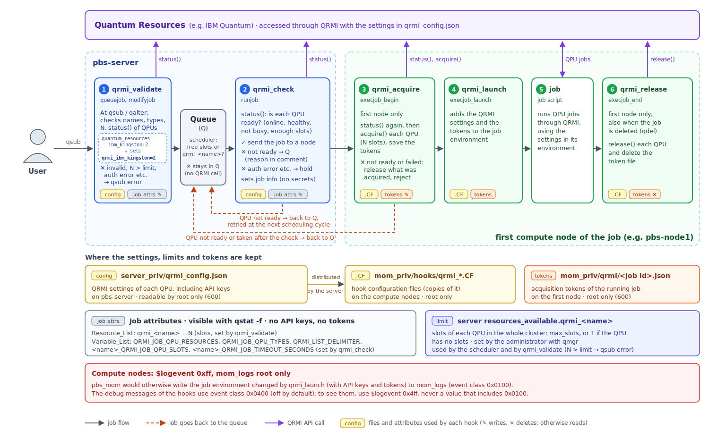

# Installation of the QRMI Hooks for OpenPBS

This document describes how to install QRMI and the PBS hooks that manage quantum resources (QPUs) through QRMI on the OpenPBS cluster containers described in [INSTALL.md](INSTALL.md).

## Jump To

- [Overview](#overview)
- [Prerequisites](#prerequisites)
- [Installing the QRMI Hooks](#installing-the-qrmi-hooks)
  - [1. Installing QRMI](#1-installing-qrmi)
  - [2. Creating the QRMI configuration](#2-creating-the-qrmi-configuration)
  - [3. Registering the hooks](#3-registering-the-hooks)
  - [4. Verifying the installation](#4-verifying-the-installation)
- [Running QPU Jobs](#running-qpu-jobs)
  - [Slots and concurrency limits](#slots-and-concurrency-limits)
  - [Using your own credentials](#using-your-own-credentials)
- [Updating and Uninstalling](#updating-and-uninstalling)
- [Troubleshooting](#troubleshooting)
  - [Log levels](#log-levels)
- [Notes and Limitations](#notes-and-limitations)

## Overview

Users request quantum resources with the `quantum_resources` job resource:

```bash
qsub -l quantum_resources=ibm_kingston job.pbs
qsub -l quantum_resources=ibm_kingston:2 job.pbs    # use 2 slots of ibm_kingston
```

Five hooks handle the request at different points of the job life cycle:

| Hook | Event | Runs on | Role |
|------|-------|---------|------|
| `qrmi_validate` | `queuejob`, `modifyjob` | `pbs-server` | Rejects `qsub` / `qalter` immediately if a requested resource is not defined, has an unsupported type, requests more slots than allowed, or QRMI reports an error that does not go away by waiting (for example invalid credentials). Sets the job's concurrency counters (`qrmi_<name>`), so that the scheduler limits the number of slots used on each resource |
| `qrmi_check` | `runjob` | `pbs-server` | Checks that each resource is online, healthy, not busy and has enough free slots, just before the job is sent to the compute nodes. If a resource is unavailable, the job goes back to the queue (without using any compute node) and is retried later. If QRMI reports an error that does not go away by waiting, the job is held instead |
| `qrmi_acquire` | `execjob_begin` | first compute node of the job | Checks the status of each resource again, acquires the resources when the job arrives on the node, and saves the acquisition tokens in a file that only `root` can read |
| `qrmi_launch` | `execjob_launch` | compute nodes | Adds the resource settings (endpoints, API keys) and the acquisition tokens to the environment of the job processes |
| `qrmi_release` | `execjob_end` | first compute node of the job | Releases the acquired resources when the job ends or is deleted, and removes the token file |


<p align="center">
  
</p>

The resources are checked on the server but acquired on the compute node. This keeps two properties at the same time:

- A job waits in the queue, without using any compute node, until its quantum resources are available.
- The number of slots used on a quantum resource at the same time is limited by the PBS scheduler, with a counter per resource set by the administrator (see [Slots and concurrency limits](#slots-and-concurrency-limits)).
- The resources are acquired only after the compute node has received the job, so `qrmi_release` always runs afterwards and releases them, even if the job is deleted before it starts.

The resource settings, including API keys, are kept in `qrmi_config.json`, which only `root` can read. The acquisition tokens are kept in a file on the compute node (`$PBS_HOME/mom_priv/qrmi/<job id>.json`), which only `root` can read. Neither is written to the job attributes, so they do not appear in `qstat -f`, the PBS datastore or the job history.

The files used in this document:

| File | Description |
|------|-------------|
| `qrmi_validate.PY` | `queuejob` / `modifyjob` hook |
| `qrmi_check.PY` | `runjob` hook |
| `qrmi_acquire.PY` | `execjob_begin` hook |
| `qrmi_launch.PY` | `execjob_launch` hook |
| `qrmi_release.PY` | `execjob_end` hook |
| `install_qrmi_hooks.sh` | Registers the hooks and their configuration on the PBS server |

## Prerequisites

- The OpenPBS cluster from [INSTALL.md](INSTALL.md) is running (`pbs-server`, `pbs-node1`, `pbs-node2`), with OpenPBS using the embedded Python 3.12.
- QRMI 0.26.0 or later (the hooks use `status_reason`, `healthy`, `busy` and `capacity` of `ResourceStatus`).
- Credentials for the quantum resources you want to use (for example an IBM Quantum API key and service CRN).
- The compute nodes do not log log event class `0x0100` (see the warning below). The `entrypoint.sh` of the cluster containers sets `$logevent 0xff` in `mom_priv/config` and makes `mom_logs` readable by `root` only.

> **Warning: API keys in mom_logs.** When an `execjob_launch` hook changes the job environment, `pbs_mom` logs the whole environment before and after the change (`env orig: ...` / `env new: ...`) with log event class `0x0100`. Because `qrmi_launch` adds the QRMI settings and acquisition tokens to the environment, **API keys and tokens would be written to `mom_logs` in plain text**. Make sure that class `0x0100` is not logged on the compute nodes before you put real credentials in `qrmi_config.json`:
>
> ```bash
> for c in pbs-node1 pbs-node2; do docker exec $c grep logevent /var/spool/pbs/mom_priv/config; done
> ```
>
> Each node should print `$logevent 0xff`. If not, rebuild the image with the current `entrypoint.sh`, or add the line to `mom_priv/config` and send `SIGHUP` to `pbs_mom` (`docker exec <node> pkill -HUP pbs_mom`). If credentials have already been logged, revoke them and remove the affected log files.

> **Note for Podman users:** The commands below use the `docker` CLI. With Podman, replace `docker` with `podman`, or define `alias docker=podman`.
>
> Commands run with `docker exec <container> <command>` do not start a login shell, so the PBS commands are not on the `PATH` (it is set in `/etc/profile.d/pbs.sh`). This document either uses full paths such as `/opt/pbs/bin/pbs_python`, or runs the commands through `bash -lc '...'`.

## Installing the QRMI Hooks

### 1. Installing QRMI

QRMI must be installed on **all three containers**: `qrmi_check` runs on `pbs-server`, and `qrmi_acquire` and `qrmi_release` run on the compute nodes.

Install it into `/opt/pbs/python/site-packages`, the directory that the hooks add to the Python module search path:

```bash
for c in pbs-server pbs-node1 pbs-node2; do
  docker exec $c python3.12 -m pip install --target /opt/pbs/python/site-packages "qrmi>=0.26.0"
done
```

> **Why not a normal `pip install`?** The Python interpreter embedded in `pbs_server` does not load the `site` module, so the standard site-packages directories (for example `/usr/local/lib64/python3.12/site-packages`) are not on its module search path, and `PYTHONPATH` is ignored. A package that imports fine with `pbs_python` on the command line can still fail with `ModuleNotFoundError` inside a server hook.

Verify the installation under the same conditions as the hooks (`-S` disables the `site` module):

```bash
for c in pbs-server pbs-node1 pbs-node2; do
  docker exec $c /opt/pbs/bin/pbs_python -S -c 'import sys; sys.path.insert(0, "/opt/pbs/python/site-packages"); import qrmi; print(qrmi.__file__)'
done
```

Each container should print `/opt/pbs/python/site-packages/qrmi/__init__.py`.

Check that the installed QRMI provides the resource types used by the hooks:

```bash
docker exec pbs-server /opt/pbs/bin/pbs_python -S -c 'import sys; sys.path.insert(0, "/opt/pbs/python/site-packages"); from qrmi import ResourceType; print([t for t in dir(ResourceType) if not t.startswith("_")])'
```

The list must include `IBMQuantumSystem`, `IBMQuantumComputeService`, `IBMQiskitRuntimeService`, `PasqalCloud`, `PasqalLocal`, `AliceBobFelis`, `IQMServer` and `OQTOPUS`. If any of them is missing, QPU jobs are rejected.

> QRMI installed this way is stored in the container's writable layer. It is kept by `docker compose restart` / `stop` / `start`, but lost when the containers are recreated (`docker compose down`, or `up -d` after a rebuild). Repeat this step after recreating the containers.

### 2. Creating the QRMI configuration

Create `qrmi_config.json` on the host. Each entry in `resources` defines one quantum resource that users can request by its `name`:

```json
{
  "resources": [
    {
      "name": "ibm_kingston",
      "type": "ibm-quantum-compute-service",
      "environment": {
        "QRMI_IBM_QCS_ENDPOINT": "https://...",
        "QRMI_IBM_QCS_IAM_ENDPOINT": "https://...",
        "QRMI_IBM_QCS_IAM_APIKEY": "<your API key>",
        "QRMI_IBM_QCS_SERVICE_CRN": "<your service CRN>"
      }
    }
  ]
}
```

| Field | Description |
|-------|-------------|
| `name` | Resource name used in `-l quantum_resources=<name>`. It is also used as the prefix of the environment variables in the job (`<name>_<key>`) |
| `type` | Resource type (see the table below) |
| `environment` | Settings passed to QRMI. The keys and values depend on the resource type |

Supported resource types:

| `type` | QRMI resource type |
|--------|--------------------|
| `ibm-quantum-system` | `IBMQuantumSystem` |
| `ibm-quantum-compute-service` | `IBMQuantumComputeService` |
| `qiskit-runtime-service` | `IBMQiskitRuntimeService` |
| `pasqal-cloud` | `PasqalCloud` |
| `pasqal-local` | `PasqalLocal` |
| `alice-bob-felis` | `AliceBobFelis` |
| `iqm-server` | `IQMServer` |
| `oqtopus` | `OQTOPUS` |

Copy the file into the server's private directory. Do **not** put it in `shared/`, which is visible on the host and in all containers:

```bash
docker cp qrmi_config.json pbs-server:/var/spool/pbs/server_priv/qrmi_config.json
```

The installation script in the next step makes it readable by `root` only.

### 3. Registering the hooks

Copy the hook files into the shared directory on the host:

```bash
mkdir -p shared/qrmi-hooks
cp ../hooks/qrmi_*.PY ../hooks/install_qrmi_hooks.sh shared/qrmi-hooks/
```

Run the installation script on `pbs-server`, then restart the server:

```bash
docker exec pbs-server bash /shared/qrmi-hooks/install_qrmi_hooks.sh
docker compose restart pbs-server
```

The script can be run again at any time. It:

1. Makes `server_priv/qrmi_config.json` readable by `root` only (mode 600).
2. Creates the `quantum_resources` custom resource (type `string`) if it does not exist.
3. For each resource in `qrmi_config.json`, creates the concurrency counter `qrmi_<name>` (a server-level consumable resource), sets its limit `server resources_available.qrmi_<name>` to 1 if it is not set yet (an existing limit is kept), adds it to the `resources:` line of `sched_config`, and makes the scheduler reload `sched_config`. See [Slots and concurrency limits](#slots-and-concurrency-limits).
4. Sets `query_other_jobs = false`, so users cannot see other users' jobs with `qstat -f`.
5. Creates, imports and enables the five hooks with their events. An existing hook is updated, including its event (for example, an older `qrmi_acquire` registered for `runjob` is changed to `execjob_begin`).
6. Imports `qrmi_config.json` as the hook configuration file of `qrmi_acquire`, `qrmi_launch` and `qrmi_release`. The server distributes it to the compute nodes.
7. Sets the timeout (`alarm`) of `qrmi_validate`, `qrmi_check`, `qrmi_acquire` and `qrmi_release` to 120 seconds, because they call remote QRMI APIs.

The script accepts the following environment variables:

| Variable | Default | Description |
|----------|---------|-------------|
| `HOOK_DIR` | directory of the script | Directory containing the `*.PY` hook files |
| `QRMI_CONFIG` | `$PBS_HOME/server_priv/qrmi_config.json` | QRMI configuration file; copied to `server_priv` if it is elsewhere |
| `QRMI_ALARM` | `120` | Timeout in seconds of the hooks that call QRMI |

> **Set the concurrency limits.** The script sets the limit of each new resource (`server resources_available.qrmi_<name>`) to 1. It does not ask QRMI for the capacity. For a resource with slots, set the limit to its `max_slots` with `qmgr` (see [Slots and concurrency limits](#slots-and-concurrency-limits)). An existing limit is never changed by the script.

> Restarting the server makes sure that the server hooks, which run inside the long-lived `pbs_server` process, load the new hook code and QRMI cleanly.

### 4. Verifying the installation

Check that the hooks are registered and enabled:

```bash
docker exec pbs-server bash -lc 'qmgr -c "list hook" | grep -E "^Hook qrmi|event|enabled"'
```

Check that the hooks and the configuration file have been distributed to the compute nodes, and that the configuration file cannot be read by regular users:

```bash
for c in pbs-node1 pbs-node2; do
  docker exec $c ls -l /var/spool/pbs/mom_priv/hooks/ | grep qrmi
done
```

`qrmi_acquire`, `qrmi_launch` and `qrmi_release` should each be listed with `.HK`, `.PY` and `.CF` files. The `.CF` files contain the API keys; they should be owned by `root` and not readable by others.

Open a shell on the server node as `pbsuser`:

```bash
docker exec -it -u pbsuser -w /home/pbsuser pbs-server bash -l
```

A request for an undefined resource is rejected immediately by `qrmi_validate`:

```bash
echo "sleep 1" | qsub -l quantum_resources=nosuch
```

```
qsub: Invalid quantum_resources: 'nosuch' is not defined. Available quantum resources: ibm_kingston
```

`qrmi_validate` also checks the status of each requested resource with QRMI. Errors that do not go away by waiting are rejected at submission time, for example invalid credentials:

```
qsub: Quantum resources cannot be used: 'ibm_kingston': authentication failed (invalid, expired or revoked credentials). Check your settings (qsub -v) or contact the administrator.
```

The details of the error are written to `server_logs`.

A job without `quantum_resources` runs as usual (the QRMI hooks do nothing for it):

```bash
echo "hostname" | qsub -W block=true
```

Run a QPU job. Save the following as `qrmi_test.pbs`, replacing `ibm_kingston` with a resource name from your configuration:

```bash
#!/bin/bash
#PBS -N qrmi_test
#PBS -l select=1:ncpus=1
#PBS -l quantum_resources=ibm_kingston
#PBS -j oe
#PBS -W umask=022

# Show the QRMI settings passed to the job (API keys are masked in the output)
env | grep -E '^(QRMI_|ibm_kingston_)' | sed -E 's/(APIKEY|TOKEN)=.*/\1=********/' | sort
```

```bash
qsub -W block=true qrmi_test.pbs
cat qrmi_test.o*
```

The output should contain `QRMI_JOB_QPU_RESOURCES=ibm_kingston`, `ibm_kingston_QRMI_JOB_ACQUISITION_TOKEN` and the `ibm_kingston_QRMI_*` settings from the configuration.

Check that neither the API key nor the acquisition token is in the job attributes (replace `<job-id>`; job history is enabled, so finished jobs can be queried with `-x`):

```bash
qstat -fx <job-id> | grep -iE "apikey|acquisition_token"     # should print nothing
```

While a QPU job is running, its token file exists on the job's first node; after the job ends, it is removed:

```bash
docker exec pbs-node1 ls -l /var/spool/pbs/mom_priv/qrmi/
```

Check that the credentials and tokens have **not** been written to the mom logs (this should print nothing):

```bash
for c in pbs-node1 pbs-node2; do
  docker exec $c bash -lc 'grep -l -E "APIKEY=|ACQUISITION_TOKEN=" /var/spool/pbs/mom_logs/*'
done
```

Check the acquisition and release in the logs (on `pbs-server` and on the job's first node). The log file names are dates in UTC:

```bash
docker exec pbs-server bash -lc 'grep -iE "qrmi|ibm_kingston" /var/spool/pbs/server_logs/$(date -u +%Y%m%d) | tail'
docker exec pbs-node1  bash -lc 'grep -iE "qrmi|ibm_kingston" /var/spool/pbs/mom_logs/$(date -u +%Y%m%d) | tail'
```

> Normal progress messages (for example "acquired" and "released") are debug messages and are not logged by default. See [Log levels](#log-levels) to enable them.

For a job on two nodes (`-l select=2:ncpus=1 -l place=scatter`), `qrmi_acquire` and `qrmi_release` should run only once each, on the first node of the job.

To check that the resources are released when a job is deleted, submit a QPU job that sleeps, delete it while it is running (`qdel <job-id>`), and check that `released` appears in the mom log of its first node and that its token file has been removed.

## Running QPU Jobs

How the hooks handle errors from QRMI:

| Error | Where | Result |
|-------|-------|--------|
| Unknown resource name or unsupported type in the request | `qsub` / `qalter` | Rejected immediately |
| Invalid number of slots (`ibm_kingston:0`), or more slots than the limit (`:2` for a resource without slots) | `qsub` / `qalter` | Rejected immediately |
| Not enough free slots in the counter (other PBS jobs are using the resource) | scheduler | Job waits in the queue (`Q`) and starts automatically when running jobs end; `qrmi_check` is not called meanwhile |
| Not enough `available_slots` reported by QRMI (e.g. used outside PBS) | before the job runs | Job waits in the queue (`Q`) and is retried |
| `qrmi.AuthenticationFailedError`, `qrmi.ResourceNotFoundError`, `qrmi.InvalidInputError`, `qrmi.UnsupportedResourceTypeError`, `qrmi.ConfigError` | `qsub` / `qalter` | Rejected immediately |
| The same errors, or a resource removed from `qrmi_config.json`, after the job was submitted (e.g. the credentials were revoked) | before the job runs | Job is held (`H`, system hold); the comment shows the reason |
| Resource offline, not healthy (`healthy = False`), busy, other QRMI errors (`qrmi.QrmiError`, e.g. network errors) | before the job runs | Job waits in the queue (`Q`) and is retried; logged as a warning |
| Errors that are not QRMI errors (e.g. a bug in a hook or invalid settings) | any hook | Job waits in the queue (`Q`) and runs once the problem is fixed; logged as an error with a traceback (`unexpected error`) |
| Resource no longer available (offline, not healthy, busy, not enough slots) or taken by another job between the check and the acquisition | first compute node | Job goes back to the queue and is retried |

Request one or more quantum resources with `quantum_resources`, separated by commas. Each name may be followed by `:<N>`, the number of slots the job uses (1 if omitted). Omit it for resources that have no slots:

```bash
#PBS -l quantum_resources=ibm_kingston
#PBS -l quantum_resources=ibm_kingston:2
#PBS -l quantum_resources=ibm_kingston,ibm_fez
```

Do not request the counters (`qrmi_<name>`) yourself; `qrmi_validate` sets them from `quantum_resources` and rejects jobs that request them directly.

The job is sent to the compute nodes only when **all** requested resources are online, healthy, not busy and have enough free slots. `healthy`, `busy` and `capacity` are used only if the resource type reports them (they are `None` otherwise). Otherwise it stays in the queue (`Q`) and is retried in the next scheduling cycle.

In rare cases, a resource becomes unavailable, or another job takes it, between the check on the server and the acquisition on the compute node. `qrmi_acquire` checks the status of each resource again (with the same conditions as `qrmi_check`) just before acquiring it. If a resource is unavailable or cannot be acquired, `qrmi_acquire` releases what it has acquired for the job and rejects it: the compute node discards the job, the server puts it back in the queue, and it is retried later.

Environment variables available in the job:

| Variable | Description |
|----------|-------------|
| `QRMI_JOB_QPU_RESOURCES` | Acquired resource names, separated by `QRMI_LIST_DELIMITER` |
| `QRMI_JOB_QPU_TYPES` | Their resource types, in the same order |
| `QRMI_LIST_DELIMITER` | Delimiter of the lists above (`:`) |
| `<name>_QRMI_JOB_ACQUISITION_TOKEN` | Acquisition token of resource `<name>` (on the first node of the job, where the job script runs) |
| `<name>_QRMI_JOB_QPU_SLOTS` | Number of slots acquired for resource `<name>` (`<N>` in `quantum_resources`; 1 if omitted) |
| `<name>_QRMI_JOB_TIMEOUT_SECONDS` | Job timeout passed to QRMI (the job's `walltime`; 6 hours if not specified) |
| `<name>_<key>` | Settings of resource `<name>` from `qrmi_config.json` (for example `ibm_kingston_QRMI_IBM_QCS_IAM_APIKEY`) |

### Slots and concurrency limits

Some quantum resources have **slots**: `status()` returns `status.capacity` with `available_slots` and `max_slots`, and a job can use several slots at the same time. Resources without slots return `status.capacity = None` and are used by one job at a time.

Each quantum resource has a concurrency counter `qrmi_<name>` (characters other than letters, digits and `_` in the name become `_`). Its limit is the number of slots of the resource in the whole cluster. The administrator sets it with `qmgr`:

- to `max_slots` for a resource with slots,
- to 1 for a resource without slots (the default set by the installation script).

The setting takes effect immediately and is kept when the installation script is run again:

```bash
docker exec pbs-server bash -lc 'qmgr -c "set server resources_available.qrmi_ibm_kingston = 4"'
docker exec pbs-server bash -lc 'qmgr -c "list server" | grep qrmi_'    # limits and current usage
```

If the limit does not match the capacity reported by QRMI, `qrmi_validate` logs a warning at each submission (`... but QRMI reports max_slots = ...`) with the `qmgr` command to fix it.

`quantum_resources=ibm_kingston:2` is handled as follows:

| Step | What happens |
|------|--------------|
| `qsub` (`qrmi_validate`) | Rejected if 2 is larger than the limit. Otherwise the job's `qrmi_ibm_kingston` is set to 2 |
| Scheduler | Starts the job only when 2 slots of the counter are free (among PBS jobs); returns them when the job ends or is deleted. Otherwise the job waits with a comment such as `Insufficient amount of server resource: qrmi_ibm_kingston` |
| `runjob` (`qrmi_check`) | If the resource reports its capacity, checks that `available_slots` is at least 2 (the slots may also be used outside PBS). Otherwise the job goes back to the queue and is retried |
| `execjob_begin` (`qrmi_acquire`) | Calls `acquire()` **once**, with `QRMI_JOB_QPU_SLOTS=2` in the QRMI configuration; QRMI acquires 2 slots |
| `execjob_end` (`qrmi_release`) | Calls `release()` once, with `QRMI_JOB_QPU_SLOTS=2` |

The job gets a single acquisition token (`<name>_QRMI_JOB_ACQUISITION_TOKEN`) and the number of slots in `<name>_QRMI_JOB_QPU_SLOTS`.

With a limit of 4:

| Job | Request | Result |
|-----|---------|--------|
| A | `ibm_kingston:2` | Runs (2 left) |
| B | `ibm_kingston:2` | Runs (0 left) |
| C | `ibm_kingston` | Waits in the queue until A or B ends |
| D | `ibm_kingston:5` | `qsub` is rejected (it could never run) |

To stop new jobs from using a resource temporarily (for example during maintenance), set its limit to 0. Running jobs continue, new jobs are accepted and wait in the queue until the limit is raised again.

The counter only limits the jobs managed by PBS. Whether the resource is actually online, not busy and has enough free slots (for example because of maintenance or users outside PBS) is checked by `qrmi_check` just before each job starts. The counter is still needed: several jobs may be started in the same scheduling cycle before any of them has acquired its slots, and the counter prevents them from using more slots than the resource has.

### Using your own credentials

To use your own credentials instead of those in `qrmi_config.json`, pass them as job variables. The hooks use the values specified by the user in preference to the configuration:

```bash
qsub -v ibm_kingston_QRMI_IBM_QCS_IAM_APIKEY=<your API key> job.pbs
```

> Values passed with `qsub -v` are job attributes, so they are visible to you (the job owner) in `qstat -f`.

## Updating and Uninstalling

**After changing `qrmi_config.json`**, copy it to `pbs-server` and run the installation script again. This also redistributes the configuration to the compute nodes:

```bash
docker cp qrmi_config.json pbs-server:/var/spool/pbs/server_priv/qrmi_config.json
docker exec pbs-server bash /shared/qrmi-hooks/install_qrmi_hooks.sh
```

**After changing a hook file**, run the installation script again (or import that hook with `qmgr -c "import hook <name> application/x-python default <file>"`), and restart the server if `qrmi_check` or `qrmi_validate` was changed:

```bash
docker exec pbs-server bash /shared/qrmi-hooks/install_qrmi_hooks.sh
docker compose restart pbs-server
```

**After upgrading QRMI** (`pip install --target ... --upgrade`) on all containers, restart the server so that `qrmi_check` loads the new version.

**To disable the hooks temporarily** (for example to run ordinary jobs while QRMI is being fixed):

```bash
docker exec pbs-server bash -lc 'for h in qrmi_validate qrmi_check qrmi_acquire qrmi_launch qrmi_release; do qmgr -c "set hook $h enabled = false"; done'
```

**To remove the hooks:**

```bash
docker exec pbs-server bash -lc 'for h in qrmi_validate qrmi_check qrmi_acquire qrmi_launch qrmi_release; do qmgr -c "delete hook $h"; done'
```

## Troubleshooting

Every log message of the hooks starts with the hook name and the job: `qrmi_check: 12.pbs-server: ibm_kingston is unavailable: busy. The job waits in the queue.` At submission the job id is not assigned yet, so `qrmi_validate` shows the user instead (`qrmi_validate: new job by pbsuser: ...`). Search by hook name or job id (the log file names are dates in UTC):

```bash
docker exec pbs-server bash -lc 'grep -E "qrmi_(validate|check):" /var/spool/pbs/server_logs/$(date -u +%Y%m%d) | tail -20'
docker exec pbs-node1  bash -lc 'grep -E "qrmi_(acquire|launch|release): <job-id>" /var/spool/pbs/mom_logs/$(date -u +%Y%m%d)'
```

**Every job, including jobs without `quantum_resources`, stays in the queue.** This happens with hooks that import QRMI before checking the job (for example older versions of these hooks). With the current hooks, only QPU jobs are affected. Check `server_logs` for `runjob hook 'qrmi_check' encountered an exception` or `rejected`.

**`ModuleNotFoundError: No module named 'qrmi'` in `server_logs`.**

1. Check that QRMI is in `/opt/pbs/python/site-packages` on `pbs-server` ([step 1](#1-installing-qrmi)).
2. Restart the server (`docker compose restart pbs-server`). If the hook tried to import QRMI before it was installed, the long-lived `pbs_server` process may remember that the directory did not exist until it is restarted.

**A QPU job stays in the queue (`Q`).** Check the job comment (`qstat -f <job-id> | grep comment`):

- `Insufficient amount of server resource: qrmi_<name>`: all slots of the counter are used by other PBS jobs (see below).
- `Waiting for quantum resources: <name>: <reason>`: `qrmi_check` found the resource unavailable. The reason is `not online`, `not healthy`, `busy`, `<N> slots requested, <M> available`, `temporary QRMI error (<type>)`, or `unexpected error (see server_logs)`. If the resource reports `status_reason`, it is appended (`(reason: ...)`).

The job starts automatically when the resource becomes available. For details, enable the debug messages (see [Log levels](#log-levels)); `unexpected error` is always logged.

**`unexpected error` in the logs.** A hook hit an error that is not a QRMI error, probably a bug in the hook or invalid settings (for example a malformed `qrmi_config.json`). The log line contains the traceback. The affected jobs wait in the queue; after fixing the problem (and importing the fixed hook), they run automatically.

**A QPU job is held (`H`).** QRMI reported an error that does not go away by waiting (for example the credentials were revoked after the job was submitted). `qstat -f <job-id>` shows the reason in `comment`, and `server_logs` shows the details. Fix the problem (for example update `qrmi_config.json` and run the installation script again), then release the job as a manager:

```bash
qrls -h s <job-id>
```

**A QPU job goes back to the queue after it was sent to a compute node.** `qrmi_acquire` found a resource unavailable, or could not acquire it, on the compute node (for example, another job took it after the check). The mom log of the job's first node shows `qrmi_acquire: <job id>: <name> is unavailable: <reason>` or `qrmi_acquire: <job id>: failed: ...` (warnings, logged by default). The job is retried later. Each such attempt counts as a run attempt (`run_count`). After more than 20 failed attempts, the server puts the job on hold with the comment `job held, too many failed attempts to run`; release it with `qrls -h s <job-id>` once the resource is available. (Rejections by `qrmi_check` happen before the job is sent and do not count.)

**A token file remains in `/var/spool/pbs/mom_priv/qrmi/` after the job has ended.** `qrmi_release` did not complete (for example, the node or `pbs_mom` stopped during the job). The file contains the resource names and tokens; release the resources manually with QRMI and then delete the file.

**A job stays in the Exiting state (`E`).** Check the mom log on the job's first node for errors from `qrmi_release` (for example QRMI not installed on that node), and for `Unable to copy file` (the job was submitted from a directory other than `/home` or `/shared`; see [INSTALL.md](INSTALL.md)).

**The QRMI settings or tokens are missing in the job environment.** Check the mom log on the job's first node for messages from `qrmi_acquire` and `qrmi_launch`, and check that `qrmi_acquire.CF` and `qrmi_launch.CF` exist in `/var/spool/pbs/mom_priv/hooks/` on the node. If they are missing, run the installation script again.

**A QPU job stays in the queue with `Insufficient amount of server resource: qrmi_<name>`.** All slots of the counter are used by running jobs. The job starts automatically when enough of them end. Check the limit and the usage with `qmgr -c "list server" | grep qrmi_`, and the jobs using the resource with `qstat -f | grep -E "Job Id|qrmi_"`.

**`qsub` reports `'<name>' is not set up in PBS`.** The concurrency counter of the resource does not exist or has no limit, for example because the resource was added to `qrmi_config.json` without running the installation script. Run the installation script again.

**`qsub` reports `Unknown resource: quantum_resources`.** The custom resource has not been created. Run the installation script again.

**Hook input and output for debugging.** With `debug = true` on a hook, PBS keeps the hook's input and output in `/var/spool/pbs/server_priv/hooks/tmp/` (server hooks) or `/var/spool/pbs/mom_priv/hooks/tmp/` (compute node hooks). These files contain the job attributes and environment, including API keys and acquisition tokens; set `debug = false` and delete them when you are done.

### Log levels

| Level | Used for | Logged by default |
|-------|----------|-------------------|
| `pbs.LOG_ERROR` | The administrator must act: a bug or broken settings (`unexpected error`), permanent QRMI errors, held jobs, resources that may remain acquired (the token is logged) | Yes |
| `pbs.LOG_WARNING` | A request was rejected, or a job is retried (logged once per event) | Yes |
| Debug (`pbs.EVENT_DEBUG3`, event class `0x0400`) | Normal progress (`accepted ...`, `acquired`, `released`), and why a job waits (`is unavailable: busy`, `not healthy`, `<N> slots requested, <M> available`, temporary QRMI errors). The reasons for waiting are logged at every scheduling cycle while the job waits | No |

`pbs.LOG_ERROR`, `pbs.LOG_WARNING` and `pbs.LOG_DEBUG` are all written with event class `0x0006`, so they are always logged; they only differ in the syslog severity. The hooks therefore use event class `0x0400` for debug messages, which is not in the default event masks of the server (`log_events = 511`) and of the compute nodes (`$logevent 0xff`).

The reasons why a job waits are also shown in the job comment, so they can be checked without enabling debug messages:

```bash
qstat -f <job-id> | grep comment
#    comment = Waiting for quantum resources: ibm_kingston: 2 slots requested, 1 available
```

To enable debug messages temporarily on the server (`qrmi_validate`, `qrmi_check`):

```bash
docker exec pbs-server bash -lc 'qmgr -c "set server log_events = 1535"'   # 511 + 0x400
docker exec pbs-server bash -lc 'qmgr -c "set server log_events = 511"'    # back to the default
```

On a compute node (`qrmi_acquire`, `qrmi_launch`, `qrmi_release`), change `$logevent` in `mom_priv/config` to `0x4ff` and send `SIGHUP` to `pbs_mom`; set it back to `0xff` afterwards:

```bash
docker exec pbs-node1 bash -c 'sed -i "s/^\$logevent .*/\$logevent 0x4ff/" /var/spool/pbs/mom_priv/config && pkill -HUP -x pbs_mom'
```

> **Do not enable event class `0x0100` on the compute nodes** (for example `$logevent 0x1ff` or `0x5ff`). With it, `pbs_mom` logs the whole job environment, including API keys and acquisition tokens (see [Prerequisites](#prerequisites)).

The debug messages of `qrmi_acquire` and `qrmi_release` contain the acquisition tokens. `mom_logs` is readable by `root` only.

## Notes and Limitations

- **pbs_mom logs the job environment.** `pbs_mom` writes the job environment changed by `execjob_launch` hooks to `mom_logs` with log event class `0x0100`, including the QRMI settings and tokens. Keep that class disabled on the compute nodes (`$logevent 0xff`), and keep `mom_logs` readable by `root` only.
- **Users can read the settings in their own jobs.** The QRMI settings, including API keys, must be in the job's environment because the job accesses the quantum resources directly. The hooks keep them out of the job attributes, the datastore and the logs, but a user can still print them from inside a job. Hiding the credentials from users completely requires a different design, such as a proxy that holds the credentials on behalf of the jobs.
- **Configuration changes after submission.** `qrmi_validate` checks the request when the job is submitted. If a resource is removed from `qrmi_config.json` or its type is changed after that, `qrmi_check` puts the job on hold, like a permanent QRMI error. A `runjob` hook cannot end a job; delete such jobs with `qdel`, or fix the configuration and release them with `qrls -h s`.
- **Classification of errors.** Only the QRMI exceptions listed in [Running QPU Jobs](#running-qpu-jobs) are treated as permanent. Other QRMI errors (subclasses of `qrmi.QrmiError`) are treated as temporary. Errors that are not QRMI errors are logged with a traceback as `unexpected error`; search `server_logs` and `mom_logs` for it after changing a hook or the configuration. The permanent errors are listed in `qrmi_validate.PY` and `qrmi_check.PY` (`permanent_errors`, with the messages shown to users in `QRMI_PERMANENT_ERRORS`); keep the two files in sync. The hooks require QRMI 0.26.0 or later and do not check for older versions.
- **Submission time.** For QPU jobs, `qsub` takes a little longer because `qrmi_validate` checks the status of each requested resource.
- **Check and acquisition are not atomic.** `qrmi_check` only checks the status; it does not reserve the resource. `qrmi_acquire` checks the status again just before `acquire()`, which narrows the window but does not close it. If the resource is unavailable or taken at that point, the job is rejected there and retried, and the compute node it was sent to is left unused for that short time. Unlike a rejection in `runjob`, a rejection in `execjob_begin` counts as a failed run attempt; more than 20 of them put the job on hold (see [Troubleshooting](#troubleshooting)).
- **Multi-node jobs.** The acquisition tokens exist only on the first node of the job (`qrmi_acquire` and `qrmi_release` run there). `qrmi_launch` also runs on the other nodes for tasks started through the PBS TM interface, and adds the resource settings there, but it cannot add the tokens. With Open MPI, `mpirun` passes its own environment, including the tokens, to all ranks, so every rank has both the settings and the tokens (checked with Open MPI 4.1 and TM). Processes started without `mpirun`, for example with `pbsdsh`, do not get the tokens on the other nodes (checked), and other MPI implementations may not pass them either. To check, run inside a job:

  ```bash
  mpirun sh -c 'echo "$(hostname): $(env | grep -c "^[^=]*_QRMI_JOB_ACQUISITION_TOKEN=") token(s)"'
  pbsdsh -- sh -c 'echo "$(hostname): $(env | grep -c "^[^=]*_QRMI_JOB_ACQUISITION_TOKEN=") token(s)"'
  ```

  With `mpirun`, every node should print 1 token per resource. With `pbsdsh`, the other nodes print 0 (only the first node has the tokens).

  If a process needs the tokens but does not get them, pass them explicitly (for example `mpirun -x <name>_QRMI_JOB_ACQUISITION_TOKEN`). Because `qrmi_launch` changes the job environment on every node of the job, keep `$logevent 0xff` on all compute nodes.
- **Node failures.** If the job's first node or its `pbs_mom` stops while the job is running, `qrmi_release` cannot run there and the resources may remain acquired. The token file on that node shows what to release.
- **Scheduling delay.** `qrmi_check` calls the QRMI status API for each resource inside the `pbs_server` process. Slow responses delay scheduling. Adjust `QRMI_ALARM` according to the actual response times.
- **Concurrency counters.** The counter name is derived from the resource name (`qrmi_<name>`); keep `counter_resource()` in `qrmi_validate.PY` and `install_qrmi_hooks.sh` in sync. Counters of resources removed from `qrmi_config.json` are not deleted by the installation script; delete them with `qmgr -c "delete resource qrmi_<name>"` after removing them from `sched_config`. `quantum_resources` of a running job cannot be changed with `qalter`.
- **Supported resource types.** The list of types is defined in `qrmi_validate.PY`, `qrmi_check.PY`, `qrmi_acquire.PY` and `qrmi_release.PY`. Keep the four files in sync when adding a type.

## END OF DOCUMENT
